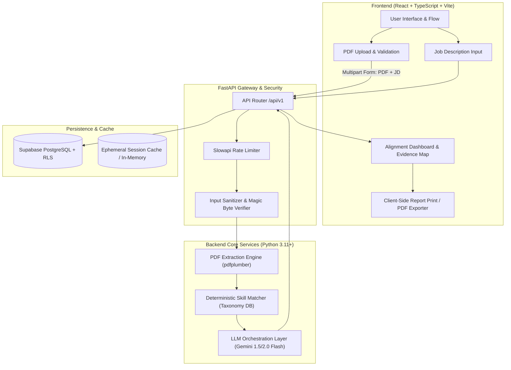
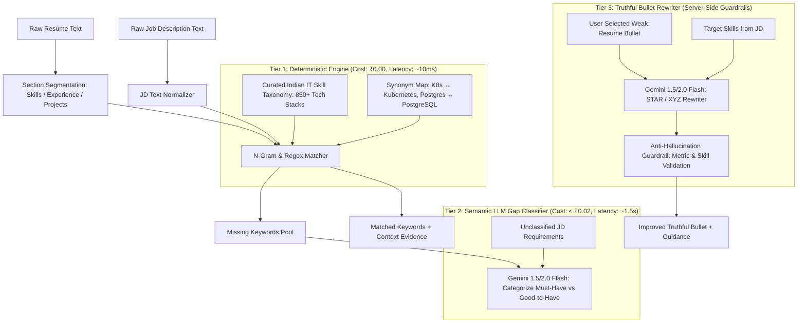

# JobMate AI — System Architecture & Technical Specifications

**Document Version:** 1.0.0  
**Status:** Under Review (Phase 0)  

---

## 1. High-Level System Architecture

JobMate AI follows a clean, decoupled client-server architecture designed for high responsiveness, zero idle hosting costs, and strict data boundary enforcement.



---

## 2. PDF Parsing Library Evaluation & Justification

Parsing tech resumes is challenging because Indian IT candidates use diverse templates:
- Single-column LaTeX / Overleaf academic templates (Jake's Resume, Deedy CV).
- Multi-column Canva / Novoresume templates with sidebars for skills and contact info.
- Microsoft Word PDF exports with varied table borders.

### 2.1 Comparative Analysis Matrix

| Feature / Metric | `pypdf` (v4+) | `pdfplumber` (v0.11+) | `PyMuPDF` (`fitz` v1.24+) | `pdfminer.six` |
| :--- | :--- | :--- | :--- | :--- |
| **License** | BSD 3-Clause (Permissive) | **MIT (Permissive)** | **AGPL-3.0 / Commercial** (Strict Copyleft) | MIT (Permissive) |
| **Layout & Multi-column Handling** | Poor to Average (extracts raw text streams, often merges columns horizontally) | **Excellent** (Advanced layout analysis with bounding box clustering) | Excellent (Extremely robust text extraction) | Very Good (Lower level API) |
| **Speed & Performance** | Fast (~0.3s for 2 pages) | **Fast (~0.6s for 2 pages)** | Blazing Fast (~0.05s) | Moderate (~0.8s) |
| **System Dependencies** | Pure Python (0 C-libraries) | **Pure Python** (depends on `pdfminer.six` & `Pillow`) | C/C++ binaries required (MuPDF build or wheel) | Pure Python |
| **Coordinate / Evidence Extraction** | Basic | **Precise** (extracts exact word coordinates and line blocks) | Precise | Verbose low-level AST |
| **Windows Compatibility** | Seamless | **Seamless (`pip install pdfplumber`)** | Wheel-dependent | Seamless |

### 2.2 Final Decision & Justification: `pdfplumber`

**Selection:** **`pdfplumber`** is chosen as the primary extraction engine with a lightweight **`pypdf`** fallback.

**Justification:**
1. **License Safety:** `PyMuPDF` enforces **AGPL-3.0**, which requires open-sourcing the entire proprietary backend codebase if distributed or used over a network under certain legal interpretations. `pdfplumber` uses the **MIT License**, guaranteeing complete freedom and zero commercial risk.
2. **Column Integrity:** Standard Indian IT resumes from Canva or Novoresume place skills in a narrow left sidebar and work experience in the right column. Standard `pypdf` reads text horizontally across lines, garbling:
   `React.js 2021 - Present Software Engineer` into incoherent tokens. `pdfplumber` respects vertical column layouts using visual layout algorithms (`extract_text(layout=True)`).
3. **Evidence Extraction:** `pdfplumber` provides line-level and character-level coordinates, making it possible to extract and highlight exact context sentences where skills appear for evidence verification.
4. **Zero Native Dependencies:** Unlike `poppler-utils` or Tesseract, `pdfplumber` installs cleanly on Windows, Linux, and macOS without requiring system-level binary installations (`apt-get install poppler-utils` or Windows DLLs).

---

## 3. Skill & Keyword Extraction Strategy: Hybrid Approach

To keep costs at **₹0** while maintaining 100% truthfulness and high speed, JobMate AI uses a **Three-Tier Hybrid Extraction Pipeline**:



### 3.1 Tier 1: Deterministic Taxonomy & N-Gram Matcher
- **Curated Taxonomy:** Over 850 Indian IT terms across:
  - *Languages:* Python, Java, JavaScript, TypeScript, Go, C++, PHP, C#, etc.
  - *Frameworks:* React, Angular, Vue, FastAPI, Django, Spring Boot, Express, Laravel, etc.
  - *Databases:* PostgreSQL, MySQL, MongoDB, Redis, Cassandra, DynamoDB, Oracle, etc.
  - *Cloud & DevOps:* AWS (EC2, S3, Lambda), Docker, Kubernetes, CI/CD, Terraform, GCP, Azure.
  - *Concepts:* Microservices, REST APIs, GraphQL, System Design, Agile, Unit Testing.
- **Synonym Normalization:** 
  - `React.js`, `ReactJS` $\to$ `React`
  - `PostgreSQL`, `Postgres`, `pg` $\to$ `PostgreSQL`
  - `K8s`, `kube` $\to$ `Kubernetes`
  - `FastAPI`, `Fast API` $\to$ `FastAPI`
- **Result:** Extracts 85–90% of skills with zero API calls, deterministic repeatability, and zero hallucination risk.

### 3.2 Tier 2: Semantic LLM Gap Analysis (Gemini 1.5/2.0 Flash)
- Runs once per scan.
- Context window passes the JD requirements and the extracted resume skill list.
- Task: Identify which non-standard JD requirements are missing (e.g., "Experience handling high-concurrency payment webhooks") and classify whether each missing item is **Critical (Must-Have)** or **Secondary (Good-to-Have)**.

### 3.3 Tier 3: Truthful Bullet Improvement Engine
- When user clicks "Improve Bullet" on a specific resume sentence:
  - Input: Original bullet point + target JD keywords.
  - System Prompt: Enforces strict adherence to existing candidate context.
  - Verification: Ensures no new company names, false dates, or unverified tools are introduced.

---

## 4. Database Schema (PostgreSQL / Supabase)

The database schema supports both guest sessions (anonymous scans with auto-cleanup) and authenticated users (saving scan history).

```sql
-- Enable UUID extension
CREATE EXTENSION IF NOT EXISTS "uuid-ossp";

-- 1. Profiles Table (Synced with Supabase Auth or standalone)
CREATE TABLE IF NOT EXISTS public.profiles (
    id UUID PRIMARY KEY DEFAULT uuid_generate_v4(),
    email VARCHAR(255) UNIQUE,
    full_name VARCHAR(150),
    created_at TIMESTAMP WITH TIME ZONE DEFAULT NOW(),
    updated_at TIMESTAMP WITH TIME ZONE DEFAULT NOW()
);

-- 2. Resumes Table
CREATE TABLE IF NOT EXISTS public.resumes (
    id UUID PRIMARY KEY DEFAULT uuid_generate_v4(),
    user_id UUID REFERENCES public.profiles(id) ON DELETE CASCADE,
    file_name VARCHAR(255) NOT NULL,
    file_size_bytes INTEGER NOT NULL,
    parsed_text TEXT NOT NULL,
    parsed_sections JSONB NOT NULL DEFAULT '{}'::jsonb, 
    -- sections structure: {"skills": [...], "experience": [...], "education": [...], "projects": [...]}
    is_ephemeral BOOLEAN DEFAULT TRUE,
    created_at TIMESTAMP WITH TIME ZONE DEFAULT NOW()
);

-- 3. Job Descriptions Table
CREATE TABLE IF NOT EXISTS public.job_descriptions (
    id UUID PRIMARY KEY DEFAULT uuid_generate_v4(),
    user_id UUID REFERENCES public.profiles(id) ON DELETE SET NULL,
    job_title VARCHAR(200),
    raw_text TEXT NOT NULL,
    extracted_skills JSONB NOT NULL DEFAULT '[]'::jsonb,
    created_at TIMESTAMP WITH TIME ZONE DEFAULT NOW()
);

-- 4. Analysis Reports Table
CREATE TABLE IF NOT EXISTS public.analysis_reports (
    id UUID PRIMARY KEY DEFAULT uuid_generate_v4(),
    user_id UUID REFERENCES public.profiles(id) ON DELETE SET NULL,
    resume_id UUID REFERENCES public.resumes(id) ON DELETE CASCADE,
    job_description_id UUID REFERENCES public.job_descriptions(id) ON DELETE CASCADE,
    
    -- Metrics
    alignment_percentage NUMERIC(5,2) NOT NULL,
    total_jd_skills_count INTEGER NOT NULL,
    matched_skills_count INTEGER NOT NULL,
    missing_skills_count INTEGER NOT NULL,
    
    -- Structured JSON payloads
    matched_skills JSONB NOT NULL DEFAULT '[]'::jsonb,
    -- structure: [{"skill": "Python", "category": "Language", "resume_evidence": "Developed microservices in Python..."}]
    
    missing_skills JSONB NOT NULL DEFAULT '[]'::jsonb,
    -- structure: [{"skill": "Kubernetes", "category": "DevOps", "importance": "Must-Have", "reason": "Explicitly required in JD"}]
    
    bullet_improvements JSONB NOT NULL DEFAULT '[]'::jsonb,
    -- structure: [{"original": "...", "improved": "...", "framework": "XYZ", "metrics_guidance": "..."}]
    
    created_at TIMESTAMP WITH TIME ZONE DEFAULT NOW()
);

-- 5. Curated Taxonomy Table (Pre-seeded for deterministic lookup)
CREATE TABLE IF NOT EXISTS public.skill_taxonomy (
    id SERIAL PRIMARY KEY,
    canonical_name VARCHAR(100) UNIQUE NOT NULL,
    category VARCHAR(50) NOT NULL, -- Language, Framework, Database, Cloud, DevOps, Concept
    synonyms TEXT[] NOT NULL DEFAULT '{}',
    is_active BOOLEAN DEFAULT TRUE
);

-- Enable Row Level Security (RLS)
ALTER TABLE public.profiles ENABLE ROW LEVEL SECURITY;
ALTER TABLE public.resumes ENABLE ROW LEVEL SECURITY;
ALTER TABLE public.job_descriptions ENABLE ROW LEVEL SECURITY;
ALTER TABLE public.analysis_reports ENABLE ROW LEVEL SECURITY;

-- Sample RLS Policy: Users can only view their own resumes
CREATE POLICY "Users access own resumes" 
ON public.resumes FOR ALL 
USING (auth.uid() = user_id OR is_ephemeral = TRUE);
```

---

## 5. API Contracts & Specifications

The backend exposes a versioned REST API (`/api/v1`) built with FastAPI, using strict Pydantic v2 validation models.

### 5.1 Endpoint Summary

| Method | Endpoint | Description | Auth Required |
| :--- | :--- | :--- | :--- |
| `GET` | `/api/v1/health` | Service health, LLM connectivity status | No |
| `POST` | `/api/v1/analyze` | Upload resume PDF + paste JD $\to$ Return full analysis | Optional (Guest/Auth) |
| `GET` | `/api/v1/analyses/{id}` | Fetch a stored analysis report | Optional (Guest/Auth) |
| `POST` | `/api/v1/bullets/improve` | Suggest truthful improvement for a single bullet point | Optional |
| `POST` | `/api/v1/report/export` | Client or server export generation payload | Optional |

### 5.2 Key Data Schemas (Pydantic Models)

#### Request: `POST /api/v1/analyze`
```python
# Content-Type: multipart/form-data
# Form fields:
#   file: UploadFile (PDF, max 5MB)
#   job_description: str (min 100, max 10000 chars)
#   job_title: Optional[str]
#   privacy_mode: bool = True (mask PII before LLM calls)
```

#### Response: `POST /api/v1/analyze` (200 OK)
```json
{
  "analysis_id": "9b1deb4d-3b7d-4bad-9bdd-2b0d7b3dcb6d",
  "created_at": "2026-10-11T12:30:00Z",
  "summary": {
    "job_title": "Backend Software Engineer",
    "alignment_percentage": 75.0,
    "matched_count": 6,
    "missing_count": 2,
    "disclaimer": "This score reflects keyword alignment with the submitted job description, not an automated ATS hiring decision."
  },
  "matched_skills": [
    {
      "name": "FastAPI",
      "category": "Framework",
      "evidence_snippet": "Engineered high-throughput REST APIs using FastAPI and Pydantic, handling 2,000+ RPM.",
      "page_number": 1
    },
    {
      "name": "PostgreSQL",
      "category": "Database",
      "evidence_snippet": "Optimized complex PostgreSQL queries and index structures, reducing slow queries by 35%.",
      "page_number": 1
    }
  ],
  "missing_skills": [
    {
      "name": "Kubernetes",
      "category": "DevOps",
      "importance": "Must-Have",
      "recommendation": "The JD lists Kubernetes deployment as a required duty. If you have deployed workloads or interacted with kubectl, highlight that specific experience."
    },
    {
      "name": "Redis",
      "category": "Database/Caching",
      "importance": "Good-to-Have",
      "recommendation": "Mentioned under preferred qualifications for caching session state."
    }
  ],
  "bullet_improvements": [
    {
      "original_bullet": "Worked on backend bugs and created APIs for the portal.",
      "suggested_bullet": "Developed and maintained RESTful microservice endpoints using FastAPI, resolving 40+ high-priority backend defects to improve service stability.",
      "framework_applied": "XYZ (Accomplished X as measured by Y, by doing Z)",
      "metrics_guidance": "If known, insert the specific defect count or uptime improvement in place of the estimates.",
      "targeted_skills": ["FastAPI", "RESTful APIs"]
    }
  ]
}
```

#### Request: `POST /api/v1/bullets/improve`
```json
{
  "original_bullet": "Managed databases and helped improve performance.",
  "target_skills": ["PostgreSQL", "Query Optimization"],
  "context_role": "Backend Developer"
}
```

---

## 6. Directory & Codebase Structure

JobMate AI is organized as a clean, modular monorepo:

```
d:/JobMate/
├── docs/                               # System documentation, PRD, architecture, security
│   ├── README.md
│   ├── 01_PRD.md
│   ├── 02_ARCHITECTURE_AND_DESIGN.md
│   ├── 03_SECURITY_PRIVACY_AND_BUDGET.md
│   └── 04_PHASED_IMPLEMENTATION_PLAN.md
│
├── backend/                            # Python + FastAPI Application
│   ├── pyproject.toml / requirements.txt
│   ├── .env.example
│   ├── app/
│   │   ├── __init__.py
│   │   ├── main.py                     # FastAPI entrypoint, middleware, CORS, routers
│   │   ├── core/
│   │   │   ├── config.py               # Settings (Pydantic-settings), Env vars
│   │   │   ├── security.py             # Magic byte check, PII masking, sanitization
│   │   │   └── rate_limit.py           # Slowapi rate limiting configurations
│   │   ├── api/
│   │   │   └── v1/
│   │   │       ├── router.py           # Combined API router
│   │   │       ├── endpoints/
│   │   │       │   ├── health.py       # Health check
│   │   │       │   ├── analyze.py      # Main analysis orchestration
│   │   │       │   └── bullets.py      # Bullet rewriter endpoint
│   │   ├── schemas/                    # Pydantic Request / Response models
│   │   │   ├── analysis.py
│   │   │   └── bullet.py
│   │   ├── services/                   # Business logic layer
│   │   │   ├── pdf_service.py          # pdfplumber parsing, column layout logic
│   │   │   ├── taxonomy_service.py     # Deterministic keyword & synonym engine
│   │   │   ├── matcher_service.py      # Keyword overlap & evidence locator
│   │   │   └── llm_service.py          # Google Gemini 1.5/2.0 Flash integration
│   │   ├── data/
│   │   │   └── tech_taxonomy.json      # Pre-compiled Indian IT skills dictionary
│   │   └── db/
│   │       ├── session.py              # Supabase/PostgreSQL connection engine
│   │       └── models.py               # SQLAlchemy models
│   └── tests/                          # Backend tests (pytest)
│       ├── conftest.py
│       ├── test_pdf_service.py         # PDF parsing & malformed PDF tests
│       ├── test_taxonomy_service.py    # Skill extraction & synonym tests
│       ├── test_matcher_service.py     # Alignment & evidence matching tests
│       ├── test_llm_service.py         # Mocked LLM prompts & zero-hallucination tests
│       └── test_api_endpoints.py       # FastAPI HTTP endpoint tests
│
├── frontend/                           # React + TypeScript + Vite
│   ├── package.json
│   ├── tsconfig.json
│   ├── vite.config.ts
│   ├── index.html
│   └── src/
│       ├── main.tsx                    # React root
│       ├── App.tsx                     # Main layout & router
│       ├── styles/
│       │   ├── variables.css           # Design tokens, color palette, typography
│       │   └── global.css              # Reset, utility classes, animations
│       ├── types/
│       │   └── analysis.ts             # TypeScript definitions (mirrors backend schemas)
│       ├── services/
│       │   └── api.ts                  # Axios/Fetch API client
│       ├── components/
│       │   ├── layout/
│       │   │   ├── Header.tsx          # Brand header with mode toggle & disclaimer
│       │   │   └── Footer.tsx          # Privacy & DPDP compliance links
│       │   ├── upload/
│       │   │   ├── FileUploadZone.tsx  # Drag & drop PDF uploader with size validation
│       │   │   └── JDInputBox.tsx      # Job description text area with char counter
│       │   ├── dashboard/
│       │   │   ├── AlignmentCard.tsx   # Visual percentage badge with clear disclaimers
│       │   │   ├── KeywordGrid.tsx     # Found vs Missing interactive tag badges
│       │   │   ├── EvidenceViewer.tsx  # Context drawer showing exact resume lines
│       │   │   └── BulletCard.tsx      # Original vs Rewritten bullet comparison
│       │   └── report/
│       │       └── ExportButton.tsx    # Clean client-side PDF/print triggers
│       └── pages/
│           ├── HomePage.tsx            # Landing & primary analysis form
│           ├── ReportPage.tsx          # Interactive report dashboard
│           └── PrivacyPage.tsx         # DPDP 2023 compliance & data rights
│
└── .gitignore
```
