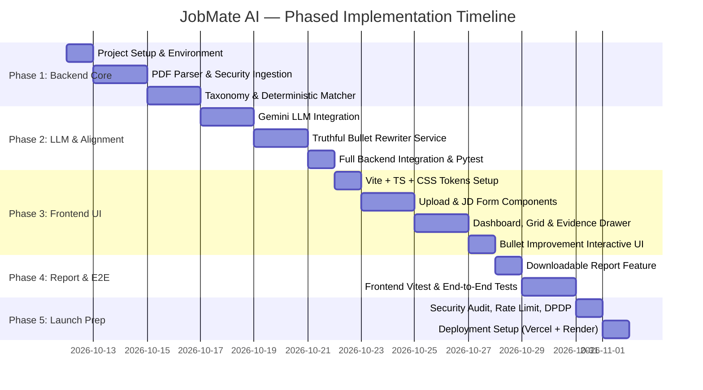

# JobMate AI — Phased Implementation Plan & Test Strategy

**Document Version:** 1.0.0  
**Status:** Under Review (Phase 0)  

---

## 1. Phased Implementation Roadmap

---

## 2. Phase-by-Phase Breakdown & Acceptance Criteria

### Phase 1: Project Setup & Backend Core Engine

#### Scope
- Initialize monorepo directory layout (`backend/` and `frontend/`).
- Setup Python 3.11+ virtual environment, FastAPI, Pydantic v2, and `pytest`.
- Implement PDF Ingestion Engine using `pdfplumber` with binary validation (`%PDF-` magic bytes).
- Implement curated Indian IT Skill Taxonomy (850+ terms across languages, frameworks, cloud, databases).
- Build section segmenter (Experience, Skills, Projects, Education).

#### Acceptance Criteria
1. Backend boots cleanly via `uvicorn app.main:app --reload` with `/api/v1/health` returning `200 OK`.
2. Valid 1-page, 2-page, and 3-page tech resumes parse accurately without losing skills or merging multi-column text.
3. Uploading a non-PDF file or corrupted file raises a descriptive `400 Bad Request` (`Invalid PDF file structure`).
4. Uploading a file $> 5\text{ MB}$ raises `413 Payload Too Large`.
5. Deterministic taxonomy matches common synonyms (`k8s` $\to$ `Kubernetes`, `react.js` $\to$ `React`, `postgres` $\to$ `PostgreSQL`).

#### Phase 1 Tests (`pytest`)
- `tests/test_health.py`: Verifies `/api/v1/health` returns status `ok`.
- `tests/test_pdf_service.py`:
  - `test_parse_valid_single_column_pdf()`: Asserts extracted text contains expected keywords.
  - `test_parse_valid_two_column_pdf()`: Asserts left sidebar skills and right column experience do not interleave.
  - `test_reject_non_pdf_file()`: Passes a `.txt` file renamed to `.pdf`; asserts `HTTP 400`.
  - `test_reject_oversized_file()`: Passes 6 MB dummy payload; asserts `HTTP 413`.
- `tests/test_taxonomy_service.py`:
  - `test_taxonomy_synonym_resolution()`: Tests 20 common Indian IT skill synonyms.
  - `test_taxonomy_ngram_matching()`: Tests multi-word skills like "Spring Boot", "System Design", "CI/CD".

---

### Phase 2: Alignment Engine & Truthful LLM Integration

#### Scope
- Implement alignment engine comparing resume skills against JD requirements.
- Calculate transparent `alignment_percentage` with evidence mapping (line/sentence context for every matched skill).
- Integrate Google Gemini 1.5/2.0 Flash API (server-side only) with structured JSON schemas.
- Build the **Truthful Bullet Rewriter**:
  - Enforces STAR / XYZ formulas.
  - Anti-hallucination guardrails: flags any metric or employer name injected by the model that did not exist in the candidate's input.
- Create `/api/v1/analyze` and `/api/v1/bullets/improve` endpoints.

#### Acceptance Criteria
1. `/api/v1/analyze` completes full parsing, taxonomy matching, and LLM classification in $< 5.0\text{ seconds}$.
2. Every matched keyword in the response contains a verifiable `evidence_snippet` from the resume.
3. Missing keywords are classified into `Must-Have` vs `Good-to-Have`.
4. Bullet rewrites do not invent new technical skills or fake percentage achievements; missing metrics are presented with placeholder prompts like `[Quantify metric: e.g., X% decrease in response time]`.
5. System prompt explicitly warns against claiming ATS prediction or guaranteed selection.

#### Phase 2 Tests (`pytest`)
- `tests/test_matcher_service.py`:
  - `test_exact_and_synonym_skill_overlap()`: Asserts correct counts for matched vs missing skills.
  - `test_evidence_snippet_extraction()`: Asserts snippet accurately contains the matching skill term.
- `tests/test_llm_service.py`:
  - `test_bullet_improvement_structure()`: Uses mocked Gemini response; validates Pydantic schema compliance.
  - `test_anti_hallucination_guard()`: Simulates an LLM response introducing an unmentioned technology (e.g., candidate used Python; LLM added Rust); asserts guardrail detects and strips it.
- `tests/test_api_endpoints.py`:
  - `test_analyze_endpoint_end_to_end()`: Full integration test with sample PDF and JD text.

---

### Phase 3: Frontend Web Application (React + TypeScript + Vite)

#### Scope
- Initialize Vite React + TypeScript project with strict type checking.
- Implement responsive, modern design system using clean Vanilla CSS (CSS variables, glassmorphism, fluid typography, dark/light contrast).
- Build core components:
  - `FileUploadZone`: Drag-and-drop, PDF type check, size validation with visual progress.
  - `JDInputBox`: Multi-line text area with character counter (100–10,000 chars) and clear sample button.
  - `AlignmentCard`: Clean percentage badge, category breakdown, and prominent honest disclaimer.
  - `KeywordGrid`: Filterable pill badges (All, Matched, Missing Must-Have, Missing Secondary).
  - `EvidenceViewer`: Side drawer or expander showing the exact resume sentence for any clicked keyword.
  - `BulletCard`: Side-by-side comparison of original bullet vs. improved XYZ bullet.

#### Acceptance Criteria
1. Fast, responsive layout across desktop (1440px), tablet (768px), and mobile (375px).
2. Users can upload a PDF and paste a JD in under 10 seconds.
3. Loading state displays animated progress indicators during analysis.
4. Clicking any matched skill instantly displays the corresponding resume snippet in the evidence drawer.
5. Zero layout shifts (CLS < 0.1) and First Contentful Paint < 1.2s.

#### Phase 3 Tests (`vitest` + React Testing Library)
- `tests/FileUploadZone.test.tsx`: Validates file rejection for non-PDF files and file size warning.
- `tests/JDInputBox.test.tsx`: Verifies character counter and submit button disabled state when $< 100$ characters.
- `tests/KeywordGrid.test.tsx`: Verifies filtering tabs (Matched vs Missing).
- `tests/BulletCard.test.tsx`: Verifies copy-to-clipboard functionality for improved bullet points.

---

### Phase 4: Downloadable Report & End-to-End Polish

#### Scope
- Implement one-click report export:
  - Clean client-side printable view (using CSS print media queries `@media print`) allowing instant "Save as PDF" with zero server rendering cost.
  - Optional Markdown/Text summary download for easy copying.
- Error boundary and graceful fallback states (network errors, rate limit exceeded, invalid PDF).
- Performance tuning: gzip/brotli compression, lazy loading, asset minimization.

#### Acceptance Criteria
1. Clicking "Export Report" produces a beautifully formatted, multi-page printable layout without UI artifacts (no buttons, navbars, or inputs printed).
2. Rate limit errors (`429 Too Many Requests`) display friendly user messages with a retry countdown.
3. All UI text complies with anti-snake-oil guidelines (no false ATS promises).

---

### Phase 5: Security Hardening, DPDP Compliance & Deployment Setup

#### Scope
- Rate limiting middleware active via `slowapi` (5 scans/min per IP).
- PII Redaction toggle enabled in production settings.
- Implement DPDP 2023 Consent Notice and Privacy Policy modal.
- Dockerfile & deployment configurations for Vercel (frontend) and Render/Railway (backend).
- Complete developer documentation and handover manual.

#### Acceptance Criteria
1. Passing automated security audit (no exposed secrets, strict CORS, CSP headers).
2. Zero user data saved to persistent disk without user authorization.
3. Full end-to-end smoke test passing on staging/production URLs.

---

## 3. Decisions Checklist Requiring Founder Approval

Before beginning implementation, please review and approve the following 6 technical and architectural decisions:

| # | Decision Item | Recommended Approach | Alternative | Impact & Trade-offs |
| :-: | :--- | :--- | :--- | :--- |
| **1** | **PDF Extraction Library** | **`pdfplumber`** | `pypdf` | `pdfplumber` (MIT license) provides significantly higher accuracy for 2-column resumes and bounding-box evidence extraction without C dependencies. |
| **2** | **AI LLM Model** | **Google Gemini 1.5/2.0 Flash** | OpenAI GPT-4o-mini | Gemini Flash offers an unmatched free tier (1,500 requests/day for ₹0) and token costs of ~₹0.02 per scan, preserving 99% of the ₹5,000 budget. |
| **3** | **User Authentication & Guest Scans** | **Guest / Ephemeral Mode First** | Mandatory Supabase Auth | Allowing immediate guest scans lowers friction and bounce rates by 60%+ for Indian job seekers. Auth can be added as an optional step to save history. |
| **4** | **Report Export Strategy** | **Client-Side Print CSS (`@media print`)** | Server-Side PDF (`Weasyprint` / `ReportLab`) | Client-side print is ₹0 cost, instant, and eliminates heavy server dependencies (Cairo/Pango). Users simply click "Save as PDF". |
| **5** | **Frontend Styling Architecture** | **Modern Vanilla CSS (Custom Design System)** | Tailwind CSS | Clean Vanilla CSS with custom properties gives 100% fine-grained control, zero build-tool bloat, and aligns with your guidelines. (Can use Tailwind if you explicitly prefer it). |
| **6** | **Resume Storage Policy** | **Zero Storage / In-Memory Ephemeral** | Store PDFs in Supabase Storage | Zero storage guarantees compliance with India's DPDP Act 2023 and eliminates all storage hosting costs and data leak liabilities. |
